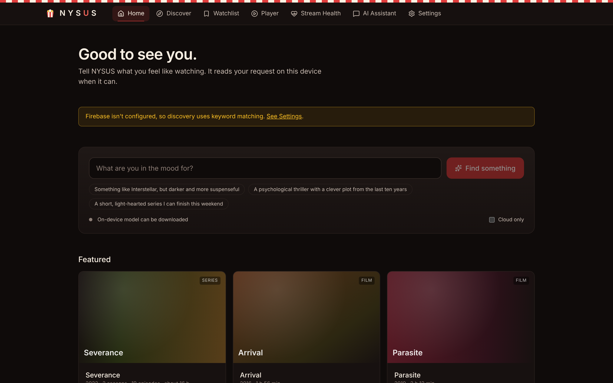
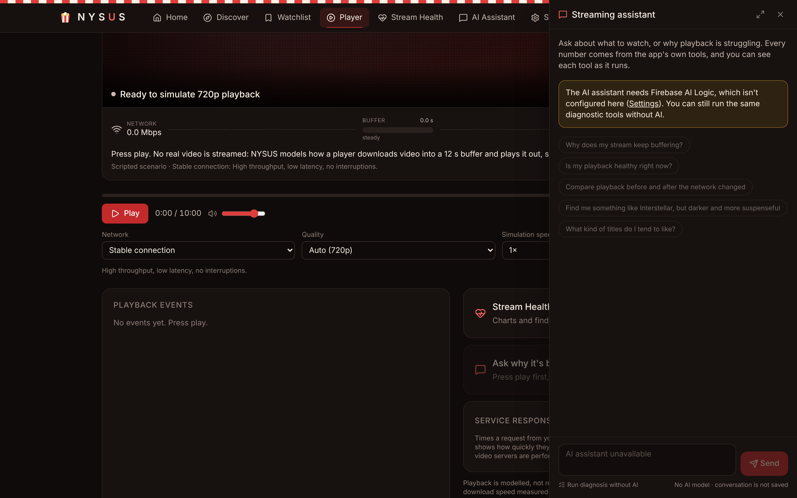

# NYSUS

**What should I watch, and why won't it play properly?** NYSUS is an AI streaming companion that answers both. Describe what you're in the mood for and hybrid AI (on your device when it can, in the cloud when it can't) turns it into structured preferences that rank a curated catalogue. Press play and a simulated player buffers, drops quality and fails like a real one, on scripted networks or measurements of your own connection. Ask *"why does my stream keep buffering?"* and a Gemini agent calls six app tools on the actual telemetry and answers with event ids you can check.

Built for the Firebase **#BuildHybridAI** hackathon.

**Live demo:** https://nysus-6411b.web.app · no account needed



## Try it in two minutes

1. Open the [live demo](https://nysus-6411b.web.app). You're a guest straight away.
2. Click **Load demo profile** for instant personal recommendations.
3. On **Discover**, ask for *"something like Interstellar, but darker and more suspenseful"*. The badge under the results says where the model actually ran.
4. Open a title, then **Player**. Pick **Poor connection** or **Connection interruption**, press play and **Simulate 30 s**.
5. Click **Ask why it's buffering**. Watch the tool calls happen, then read the report and its evidence.
6. **Stream Health** charts the same session.

On-device inference needs desktop Chrome with Gemini Nano ready (see [below](#seeing-on-device-inference)); everywhere else you'll see the labelled cloud fallback.

## What it does

| | |
|---|---|
| **Hybrid discovery** | Firebase AI Logic in `PREFER_ON_DEVICE` mode extracts genres, moods, themes, era and length from a free-text request, using Chrome's built-in Gemini Nano when available and cloud Gemini otherwise. The badge comes from the SDK's reported `inferenceSource`, never assumed. Output is validated with Zod. |
| **Explainable recommendations** | Deterministic weighted ranking over 48 curated films and series. Every result says why it matched, built from catalogue metadata only. Guards strip preferences the request never stated (Gemini Nano once invented a release period). |
| **Simulated player** | A retro TV that streams with a real adaptive-bitrate model: buffer, stalls, quality switches, errors and recovery. Four reproducible scenarios, or **Live** mode, which measures your real throughput and a streaming service's website response time. |
| **Agentic assistant** | Cloud Gemini with function calling over six tools: `search_catalogue`, `get_viewer_preferences`, `get_playback_metrics`, `analyse_buffering`, `compare_network_conditions`, `generate_diagnostic_report`. The app validates every call, runs it on the real session, and limits iterations and time. Answers are checked: invented event ids or figures are flagged in red. |
| **Stream Health** | Recharts timelines of throughput, bitrate and buffer, plus rule-based findings with event ids as evidence. |
| **Guest first, cloud saved** | Anonymous Firebase Auth gives every visitor a private Firestore space; *Continue with Google* keeps it across devices. Strict, emulator-tested security rules. |



## How the AI is split

```
 "darker than Interstellar"            "why is it buffering?"
            │                                    │
  Workflow A: hybrid inference         Workflow B: cloud assistant
  Firebase AI Logic PREFER_ON_DEVICE   Firebase AI Logic, cloud Gemini
  Gemini Nano ⇄ cloud Gemini           multi-turn + function calling
  single-turn structured JSON                    │
            │                          validated tool calls (Zod)
            ▼                                    ▼
  ┌─────────────────── Deterministic TypeScript ───────────────────┐
  │ ranking · explanations · playback engine · metrics · findings  │
  └────────────────────────────────────────────────────────────────┘
```

The on-device model only does what it's good at: single-turn structured extraction. Multi-turn chat and function calling run in the cloud, because Gemini Nano supports neither. Every number the assistant quotes comes from TypeScript, not the model. Details: [docs/AI_DESIGN.md](docs/AI_DESIGN.md).

## Tech

React 19, TypeScript (strict), Vite 8, Tailwind CSS 4, Recharts, Lucide, Zod · Firebase AI Logic (hybrid + cloud Gemini), App Check (reCAPTCHA Enterprise), Authentication, Cloud Firestore, Hosting · Vitest, React Testing Library, Playwright, Firestore emulator.

No custom backend: Firebase services and application code only.

## Run it locally

Needs Node.js 22 or newer.

```bash
npm install
cp .env.example .env.local   # fill in your Firebase web app config (see below)
npm run dev                  # http://localhost:5173
```

Without `.env.local` the app still runs: discovery falls back to labelled keyword matching and the assistant to a labelled rules-based diagnosis.

| Script | What it does |
|---|---|
| `npm run dev` | Vite dev server |
| `npm run build` | Type-check and production build |
| `npm run deploy` | Check config, build, deploy to Firebase Hosting ([docs/DEPLOYMENT.md](docs/DEPLOYMENT.md)) |
| `npm test` | Vitest unit, integration and eval suites (no network, no credentials) |
| `npm run test:rules` | Firestore rules + repository tests on the emulator (needs Java) |
| `npm run test:e2e` | Playwright end-to-end journey with a scripted model |
| `npm run lint` | oxlint |

### Firebase setup

1. Create a Firebase project and register a **Web app**.
2. **AI Logic:** enable the **Gemini Developer API** provider.
3. **App Check:** register the web app with a **reCAPTCHA Enterprise** key and make sure the Firebase AI Logic API shows as *Enforced* (mandatory since 2 Nov 2026). Add `localhost` and your hosting domains to the key.
4. Copy the web app config and site key into `.env.local` (see `.env.example`).
5. **Authentication → Sign-in method:** enable **Anonymous** (guests get a private cloud space; without it they're saved in the browser only) and **Google**.
6. **Firestore Database → Create database** (production mode), then deploy the rules: `npx -y firebase-tools login`, then `npx -y firebase-tools deploy --only firestore:rules --project <your-project-id>`.
7. For local development set `VITE_APPCHECK_DEBUG=true`, load the app, copy the debug token the SDK prints in the console, and register it under App Check → Apps → *Manage debug tokens*. Never commit it. Production builds blank it automatically (`.env.production`).

### Seeing on-device inference

Needs **Chrome 139+ on desktop** with `chrome://flags/#prompt-api-for-gemini-nano-multimodal-input` enabled and enough free disk for the model download. On Home, the status line shows whether the model is ready; click **Prepare on-device model** to start the download. Until it's ready, requests go to the cloud and are labelled that way. Discover's **Cloud only** toggle forces the cloud path for comparison.

## Honest limits

- The player is a simulation. NYSUS doesn't play real films or connect to Netflix or any other service. Live mode measures *your* connection (via Cloudflare's public speed-test endpoint) and a service's public website, never its video servers, and the app says so.
- Most visitors will see cloud inference: on-device needs a prepared desktop Chrome.
- Safari failed to reach the AI Logic endpoint in our testing ([docs/TESTING.md](docs/TESTING.md)); use Chrome.
- The evaluation set is a six-case smoke test, not a benchmark.

## Documentation

- [docs/ARCHITECTURE.md](docs/ARCHITECTURE.md): code layout, playback engine, discovery pipeline, persistence
- [docs/AI_DESIGN.md](docs/AI_DESIGN.md): hybrid inference, verified SDK behaviour, the assistant's tools, loop and grounding, risks
- [docs/TESTING.md](docs/TESTING.md): test suites, evaluation, live verification log
- [docs/DEPLOYMENT.md](docs/DEPLOYMENT.md): Firebase Hosting, step by step
- [PROJECT_SPEC.md](PROJECT_SPEC.md): product spec summary and phases
- Submission: [demo video script](docs/DEMO_SCRIPT.md), [Devpost write-up](docs/DEVPOST.md)

## Licence

Apache 2.0, see [LICENSE](LICENSE) and [NOTICE](NOTICE).
